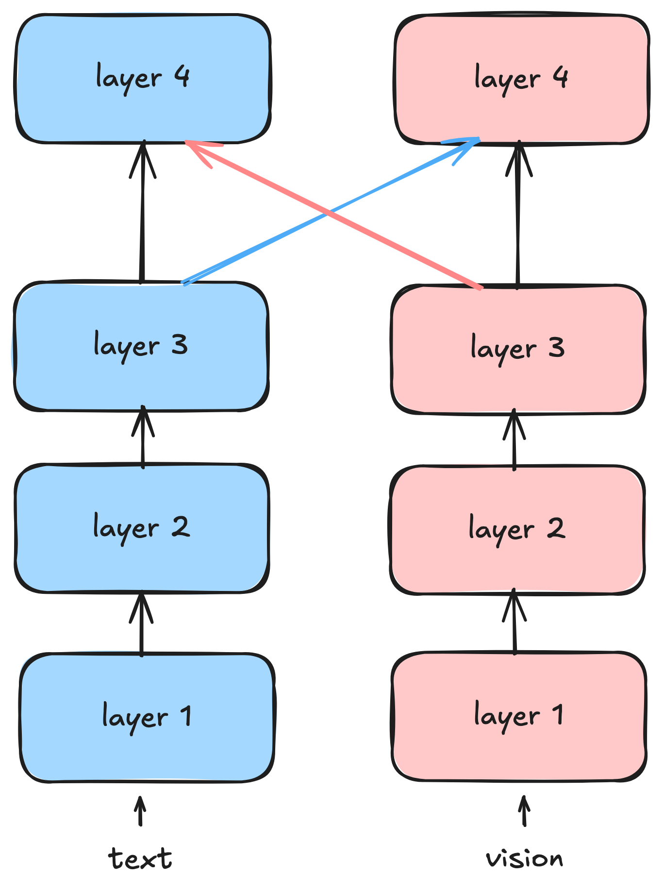
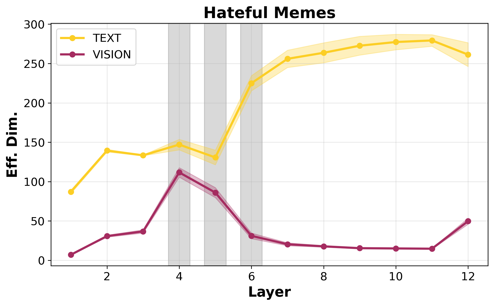
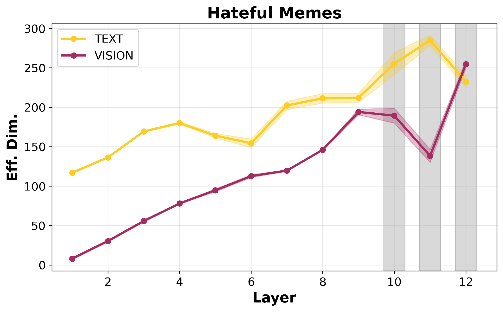
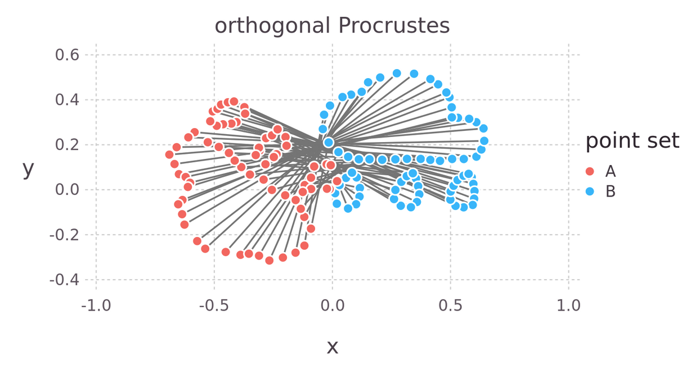
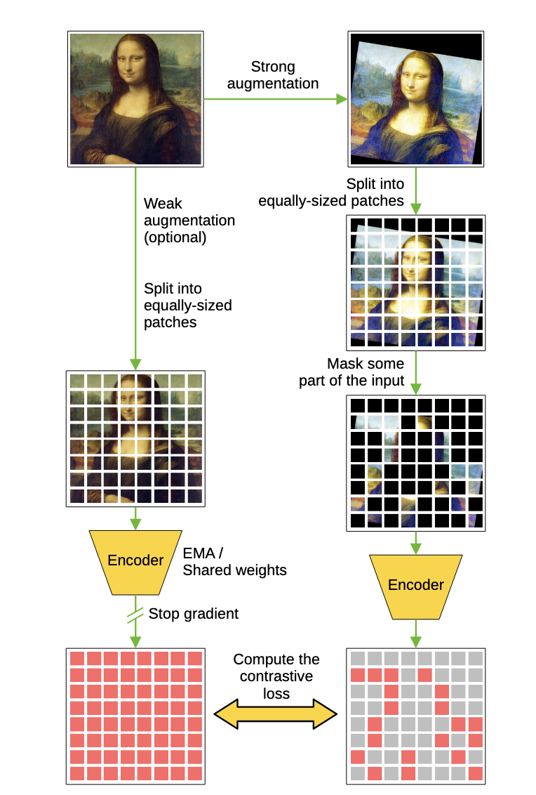

# Code for bachelor thesis

This repository contains the code for my bachelor thesis: Probing Layer-wise Alignment Depth in Multimodal Transformers. It is a PyTorch implementation of ViLBERT, a model that combines visual and language understanding.

## Autoresearch workspace

Run **`./research`** after logging into a node for the cross-session dashboard.
Use **`./research dashboard --watch`** to monitor activity and
**`./research review`** to judge proposed next experiments. The
[coordination guide](autoresearch/concurrency/README.md) covers unique local
sessions, shared GPU ownership and isolated experiment outputs.

**For the current experiment, findings and next steps, read [STATUS.md](STATUS.md).**
It is the curated scientific overview; its timestamp says when runtime evidence
was last checked. The technical files below provide supporting detail.

This checkout is the autonomous research workspace; `../bsc-code` is the
read-only manual/input checkout. **This is a shared university GPU machine.**
Follow [AGENTS.md](AGENTS.md) for resource, workspace and session boundaries.
The objective and reference material are in [AUTORESEARCH.md](AUTORESEARCH.md),
the systematic protocol in [program.md](program.md), and current progress in
[todo.md](todo.md). Start with the [campaign report](autoresearch/CAMPAIGN_REPORT.md),
[results index](autoresearch/README.md) and [handoff](autoresearch/HANDOFF.md).
The 2026-10-22 follow-up adds [measured training-speed options](autoresearch/TRAINING_SPEED.md),
[reverse-fusion controls](autoresearch/reverse_summary.md), and a
[late-seed status update](autoresearch/late1571_update.md).
The latest [autonomous training report](autoresearch/AUTONOMOUS_TRAINING_REPORT.md)
records six paired input-scale training runs and their limits.
Current checkpoint findings are exploratory; the thesis interpretations below
do not establish replication across independent pretraining seeds.

The 2026-10-23 functional follow-up has completed DF1/DF2 message interventions:
[all-condition results and geometry figure](autoresearch/gate-analysis/outputdrafts/full500/gate-analysis.md),
[raw loss, calibrated loss and AUROC figure](autoresearch/gate-calibration/results/utility-figure-df1-df2-v2/utility-comparison.png),
and [independent interpretation](autoresearch/workshop/full500_review.md).
These use existing fine-tunes; they are inference experiments with no new training.

The four-checkpoint extension is now complete for DF1, DF3, DF2, and REV, with
N=500 per checkpoint, all 28 gate conditions, and 677.106 seconds of GPU-job
wall. It is inference on existing fine-tunes; no weights were trained. See the
[all-condition report](autoresearch/gate-analysis/outputdrafts/all-four-models/gate-analysis.md)
and [CSV](autoresearch/gate-analysis/outputdrafts/all-four-models/gate-analysis.csv),
[directional response and shared-temperature analysis](autoresearch/gate-extension/analysis/directional-response-table.md),
[compact figure PNG](autoresearch/gate-extension/figures-v2/four_model_cross_attention_gates.png)
and [PDF](autoresearch/gate-extension/figures-v2/four_model_cross_attention_gates.pdf),
and [independent four-model review](autoresearch/workshop/four_model_findings.md).
The first/third-event phase is complete for both existing N=500 fine-tunes
(317.537 seconds GPU-job wall, no training). All capture controls passed, and
the CPU analysis and independent raw-logit/geometry verification agree. The
predeclared row-L2 CKA G0 values are +0.000617109 (DF1) and +0.120365300 (DF2),
contradicting the exploratory negative-direction prediction. Raw-centered CKA
changes sign relative to row-L2 CKA for DF1 event 0 and DF2 event 2. All six
raw BCE changes are positive, while AUROC changes are small and mixed; no
equivalence test was run. See the [analysis record](autoresearch/event-gate/analysis/execution-record.md),
[independent verification](autoresearch/workshop/event_result_verification/report.md),
[figure PNG](autoresearch/event-gate-figures/outputs-v3/event_gate_local_response.png)
and [PDF](autoresearch/event-gate-figures/outputs-v3/event_gate_local_response.pdf),
and [post-hoc local-dose report](autoresearch/event-local-dose-diagnostic/report.md).
The 30-point dose curves are CPU-only local residual reconstructions; they do
not evaluate downstream layers or select an optimal dose. The [completed
session](autoresearch/event-gate/session.json) and preserved
[activation snapshot](autoresearch/event-gate/session-active-execution-snapshot.json)
record execution provenance. The locked-809 reevaluation is complete for DF1, DF3, DF2, and REV. The fixed
captures used 1,277.401 seconds of GPU-job wall and 296,464,424 bytes. An
initial CPU reader stopped before scoring on a serialized JSON key-order
assumption; the reviewed v2 CPU-only repair analyzed the already closed
captures, without new model forwards, GPU work, or training. Its [28-condition
table](autoresearch/locked-reeval-figures/outputs-v3/locked_reeval_all_conditions.md)
and [CSV](autoresearch/locked-reeval-figures/outputs-v3/locked_reeval_all_conditions.csv),
[four-checkpoint primary comparison](autoresearch/locked-reeval-figures/outputs-v3/locked_reeval_primary_comparison.md)
and [CSV](autoresearch/locked-reeval-figures/outputs-v3/locked_reeval_primary_comparison.csv),
plus [PNG](autoresearch/locked-reeval-figures/outputs-v3/locked_reeval_primary_comparison.png),
[PDF](autoresearch/locked-reeval-figures/outputs-v3/locked_reeval_primary_comparison.pdf),
and [source-hash manifest](autoresearch/locked-reeval-figures/outputs-v3/locked_reeval_source_hashes.json)
retain every condition and provenance. Independent CPU verification reproduced
all 28 raw BCE/AUROC, per-class, frozen-temperature, and component-range metrics;
raw CKA matched exactly and row-L2 CKA differed by at most 1.31e-9. The
[verification report](autoresearch/workshop/locked_reeval_verification/report.md)
and [full comparison record](autoresearch/workshop/locked_reeval_verification/analysis-comparison-full.json)
contain the calculations. For the predeclared alpha=0.5/vision text-to-vision
raw-BCE primary, N=809 changes are +0.004136 (DF1), +0.006835 (DF3), +0.022083
(DF2), and -0.001904 (REV). A secondary DF2 alpha=0.5/text vision-to-text
AUROC change reverses from -0.010754 at old N=500 to +0.006218 at N=809; these
cohorts differ, so the reversal is descriptive and not population confirmation.
N=809 test_seen is historically exposed, and these fixed checkpoints are not
independent pretraining-seed replications. See the [v2 repair completion](autoresearch/locked-reeval-cpu-repair/batch-completion-v2.json),
[capture record](autoresearch/locked-reeval/capture-completion.json), [protocol](autoresearch/locked-reeval/protocol-feasibility.md),
and [engineering review](autoresearch/workshop/locked_reeval_engineering_review.md).

The full-forward dose and checkpoint-robustness v3 captures are closed for
DF1, DF2, early seed 1570 and early seed 1571. All seven conditions and declared
capture controls passed; the four jobs used 1,126.838 seconds of GPU-job wall
and produced 1,279,184,864 bytes. This was inference on existing fine-tunes,
with no new weights. The production CPU analysis and independent comparison
passed: all 28 raw/OOF condition metrics, 20 fold temperatures, and eight
primary CKA readouts matched; the maximum row-L2 CKA difference was 4.65e-9.
The analysis is conditional on the previously exposed N=500 dev_seen cohort.
See the [dose curves PNG](autoresearch/full-dose-figures/outputs-v1/full_dose_curves.png)
and [PDF](autoresearch/full-dose-figures/outputs-v1/full_dose_curves.pdf),
[bias-control table](autoresearch/full-dose-figures/outputs-v1/bias-control-values.md)
and [CSV](autoresearch/full-dose-figures/outputs-v1/bias-control-values.csv),
[bias-control figure PNG](autoresearch/full-dose-figures/outputs-v1/bias_control_points.png)
and [PDF](autoresearch/full-dose-figures/outputs-v1/bias_control_points.pdf),
complete [condition table](autoresearch/full-dose-figures/outputs-v1/all-condition-summary.csv),
[all event/state geometry](autoresearch/full-dose-figures/outputs-v1/all-geometry-states.csv),
[event-local geometry gains](autoresearch/full-dose-figures/outputs-v1/all-event-geometry-gains.csv),
[plotted values](autoresearch/full-dose-figures/outputs-v1/plot-values.csv), and
[source/input hashes](autoresearch/full-dose-figures/outputs-v1/source-hashes.json).
The rejected
[v1](autoresearch/full-dose-seed-study/) and
[v2](autoresearch/full-dose-seed-study-v2/) startup packages remain preserved
alongside the [v3 protocol](autoresearch/full-dose-seed-study-v3/protocol.md),
[session](autoresearch/full-dose-seed-study-v3/session.json), and four
[job contracts](autoresearch/full-dose-seed-study-v3/jobs/). See the
[capture-completion record](autoresearch/full-dose-seed-study-v3/capture-completion.json).

The nested-regularization positive-control follow-up is complete on the same
exposed 500-row cohort. The CPU-only run elapsed 58.246 seconds and peaked at
260.020 MiB RSS, with no GPU, checkpoint load, or training. Final text+vision CLS AUROCs
of 0.6973 (DF1) and 0.7490 (DF2) support late joint label accessibility on this
cohort; earlier event probes are weak and mixed, and DF2 vision BCE remains
above the labels-only prior. The original fixed-C=1 results remain separately
preserved. These probes do not establish information retention. See the
[results summary](autoresearch/probe-positive-control/display/results-summary.md)
and [independent output verification](autoresearch/workshop/probe-positive-control-verification/README.md).
The message-pairing v1 startup stopped before model loading or a forward pass
because its runner could not import `event_gate_common`. V2 activated at
2026-10-23 17:59:50 UTC for inference-only analysis of the four existing
Hateful Memes fine-tunes, using five fixed donor maps and replay/zero controls;
no training or new weights were involved. Its first DF1 attempt aborted after
capture during the final inherited-pin check with `NameError: V3_INPUT_PINS_PATH`
at `run_message_pairing.py:1239`. No result summary or runner metrics were
written, so its preserved archives/cache are not accepted outcomes. The v2
queue was halted at that point with no owned GPU job active; this is a
historical v2 state.

Message-pairing v3 inference is complete for four existing checkpoints; all
captures, production analysis and the independent numerical comparison passed.
The [corrected results display](autoresearch/message-pairing-figures/outputs/message-pairing-v3-20261023-label-correction/results-summary.md)
and [findings](autoresearch/workshop/message-pairing-findings.md) give the
conditional interpretation. See [STATUS.md](STATUS.md) for the current result
summary and next step. The planned paired-versus-shuffled HM fine-tuning study
uses six serial runs (seeds 41001–41003, ten epochs per arm) from one existing
DF1 pretraining parent, with 5,856 training, 656 inner-validation and 1,591
locked-holdout rows; no new pretraining is planned. Root activated the serial
queue at 2026-10-23 19:25:15 UTC. The holdout remains sealed during training.
See [STATUS.md](STATUS.md) for the completion table and currently running arm,
and the [declared protocol](autoresearch/paired-message-training/PROTOCOL.md) for the fixed design.


### GPU training is authorized

The user explicitly authorizes autonomous GPU experiments here, including
**full pretraining and fine-tuning runs lasting hours or days**, to investigate
induced representational alignment for the publication. This workspace is not
restricted to inference, short pilots, or CPU analysis. Routine experiments
within that objective do not need another approval. Use the GPU for substantive
comparisons with fixed protocols, saved checkpoints, logs, and analysis.

This remains shared **university infrastructure**: preserve other people's jobs,
use the current host/allocation, and run one owned GPU job at a time. A finite
budget means a defined epoch/step count, resource limits and stop conditions;
it does not mean a short experiment. Do not change system settings, acquire
remote machines, or modify the normal `../bsc-code` checkout. Keep all new code,
training checkpoints, caches and results in this autoresearch worktree.

The user removed the **50% weekly-usage stop** for new/current work on
2026-10-23. This does not assume that a quota reset happened. Account polling is
optional, and missing, unavailable or old readings do not stop work. If the
standalone usage helper is explicitly used, its default is 100% (natural account
exhaustion). Use [the active policy](autoresearch/active_usage_policy.json);
preserve limits embedded in old closed session contracts. The account limit and
GPU runtime are separate quantities. During a guarded run, report quota records
with their actual source and observation time; appending a record does not make
an old observation fresh.

Completed: eight checkpoint extractions separating the cross-modal update,
residual addition, LayerNorm, and FFN in both streams (results below).
Running: full-recipe matched-seed delayed-vision versus delayed-text pretraining,
using 500,000 Conceptual Captions pairs for seven epochs per architecture.
The [training protocol](autoresearch/full_training_protocol.md) specifies the
comparison, checkpointing and stop conditions. The
[controller state](autoresearch/full-training/controller-state-prefetch-phase2.json) records
whether training has actually started and which arm is active.
Track actual launch/completion status in [todo.md](todo.md) and the
[handoff](autoresearch/HANDOFF.md). Preparing a run does not mean it is running.

The baseline reached 69 applied updates with zero AMP skips and a saved
checkpoint. Input stalls motivated a separately versioned
[prefetch and duration follow-up](autoresearch/full_training_prefetch_protocol.md).
The prefetch phase has now launched from the same pinned initial weights;
both architectures use that backend, with 240 hours per arm and 21 days for
the phase. The scientific recipe and seven-epoch exposure stay fixed. Its
[input audit](autoresearch/full-training/prefetch-adoption-review.json) documents
small image-rounding differences, so this is not an exact numerical continuation
of the baseline. All first 20 new GPU updates applied with finite losses and a
saved checkpoint; training has continued beyond 40 updates. The first-20
windows averaged 23.13 seconds versus 72.72 seconds for the baseline's last
five. This comparison is cache-confounded and does not establish full-run
throughput. The [reference check and timing report](autoresearch/full-training/backend-validation/prefetch-first20-review.md)
records matching data, cursor, RNG, scaler and scheduler, with the documented
floating differences. Live state and logs provide current progress.

The current experiment compares DF2 (text blocks 3–5, vision blocks 9–11) with
REV (text blocks 9–11, vision blocks 3–5) from identical seed-1804 weights, using
the same data, objectives, optimizer and exposure. It tests whether reversing
which stream matures before cross-attention changes induced alignment and
both-stream dimensionality. Final-epoch checkpoints are the primary endpoint;
alignment and matched downstream fine-tunes will be evaluated separately.

### Delayed fusion: current completed results

Fusion occurs before the listed **zero-based** backbone blocks, pairing entries
by ordinal event. REV delays **text**; DF1/DF3/DF2 delay vision progressively.
These historical test results use one pretraining/fine-tuning seed (1567) per
configuration, and are not evidence of replicated architecture effects.

| Configuration | Text insertion IDs | Vision insertion IDs | HM AUROC | MM-IMDb macro-F1 | UPMC accuracy |
|---|---|---|---:|---:|---:|
| DF1: vision +2 | 3, 4, 5 | 5, 6, 7 | 0.7218 | 0.5225 | 0.9051 |
| DF3: vision +4 | 3, 4, 5 | 7, 8, 9 | 0.7415 | 0.5185 | 0.9225 |
| DF2: vision +6 | 3, 4, 5 | 9, 10, 11 | 0.7455 | 0.5207 | 0.9261 |
| REV: text +6 | 9, 10, 11 | 3, 4, 5 | 0.7183 | 0.5377 | 0.8954 |

All four have completed all three fine-tunes. Later vision insertion improves
HM/UPMC across these saved runs, while MM-IMDb macro-F1 does not follow that
ordering and favors REV. Checkpoints, metric sources and seed limitations are
in the [verified inventory](autoresearch/induced_alignment_inventory.md).
The [research-material review](autoresearch/induced_alignment_material_review.md)
links the meeting notes, thesis and papers to the hypotheses and evidence gaps.
The [new stage protocol](autoresearch/fusion_stages_protocol.md) separates the
cross-modal update from normalization and FFN effects instead of attributing
the whole block's behavior to attention alone.

### Before and after cross-attention: measured results

All eight extractions completed: four pretrained checkpoints and their four
Hateful Memes fine-tuned descendants, each on the same 500 `dev_seen` examples.
They consumed 7.7 minutes of GPU-job wall time. The
[complete table and definitions](autoresearch/fusion-stages-analysis/fusion_stage_summary.md)
report three insertion events per checkpoint, separating the two streams.
An [independent review](autoresearch/fusion_stages_independent_review.md)
recomputed selected metrics and verified the residual identities, unchanged
model outputs, and replay of previously saved features.

- The first cross-attention block increases corrected CKA in all eight
  checkpoints, with most of that increase already present after adding the
  projected cross-modal message to the residual.
- At the second insertion, full-block CKA decreases for all six delayed-vision
  checkpoints, but increases slightly for both delayed-text checkpoints.
- The FFN sublayer, including its normalization and residual addition, lowers
  corrected CKA and text participation ratio in all 24 measured events.
  The preceding attention-output LayerNorm changes corrected CKA by less than 0.003 here.
  A whole-block change therefore cannot be attributed to attention alone.


[Fine-tuned figure](autoresearch/fusion-stages-analysis/fusion_stage_trajectories_finetuned.png)
and [downloadable comparison table](autoresearch/fusion-stages-analysis/fusion_stage_comparison_table.csv).

These are descriptive findings from one pretraining seed per architecture;
fine-tuned descendants and insertion events are not independent seed repeats.
The cohort was already exposed during discovery. CKA and participation ratio
use row-normalized, centered features, with CKA corrected against 200 fixed
pairing permutations. Historical raw-feature metrics can show different change
directions, so comparisons must preserve the normalization convention. These
measurements motivate the new matched training comparison; they do not yet
establish a causal performance benefit or a general architecture ranking.

### Sensitivity to feature normalization

A post-hoc sensitivity analysis, independently checked from the saved features,
compares raw-feature-centered metrics with metrics after row-L2 normalization
and centering. From post-LN to the final full-block output, observed and
null-corrected CKA and text PR decrease in all 24 event/checkpoint pairs under
both conventions; vision PR decreases in 23/24 under each. PRE-to-full
corrected-CKA change reverses sign across conventions in 4/24 pairs. The
residual-sum-to-post-LN PR change reverses sign in 15/24 pairs for each stream.
These are descriptive counts on the exposed `dev_seen` cohort; event rows and
fine-tuned descendants are not independent seed replications. The post-LN to
full-block comparison is a state transition, not an isolated or general
LayerNorm effect.

See the [normalization report](autoresearch/fusion-stage-normalization/fusion_stage_normalization_sensitivity.md),
[independent review](autoresearch/fusion-stage-normalization/independent_review.md),
and [sign-flip figure](autoresearch/fusion-stage-normalization/normalization_sign_flip_counts.png).

### Vision-stream dimensionality across depth: measured results

A CPU-only analysis of the 17 cached CLS feature sets (no new inference, 845 s
on four threads) follows the number of principal directions in each stream layer
by layer, using the thesis metric (PCA at 95% variance) and scale-robust
alternatives. See the [report](autoresearch/collapse-analysis/COLLAPSE_REPORT.md),
[all tables](autoresearch/collapse-analysis/tables.md) and the
[analysis code](src/analyses/autoresearch_collapse_analysis.py).

- Three early and three late pretrains separate completely in vision PCA95 at
  every layer from L4 to L11 (L5–L8: early 15–33, late 96–133; final layer 46–57
  vs 147–169 at N=500). The text stream shows no early-fusion deficit.
- The decrease happens at the **second** cross-attention step in all ten fused
  checkpoints; the first step *raises* vision rank in early, DF1, DF3 and REV.
  Late fusion also compresses at L10 and rebounds at L11, and the L10→L11 rise
  also occurs in the no-cross-attention baseline.
- That baseline has the lowest rank at every layer, so early fusion is
  "collapsed" relative to late fusion, not relative to a stream without text.
- PCA95 grows with the number of rows used (late s1570: 76 / 121 / 150 / 169 at
  125 / 250 / 375 / 500 rows) while the checkpoint order is stable. One channel
  (index 16) holds 41% / 31% of the CLS variance at DF1 L6 / DF3 L8, so raw
  participation-ratio dips there are not rank collapse.
- Final-layer vision rank follows Hateful Memes AUROC across the seven 2026
  checkpoints (Spearman +0.89), but schedule is confounded with both. Across
  10 checkpoints it does not support "low rank inflates raw CKA" (ρ +0.25…+0.30).


These are descriptive results on pretrained checkpoints, CLS features only, one
exposed 500-row Hateful Memes cohort, one pretrain per schedule except three
early and three late, and a single 2025 no-cross-attention baseline. Whether low
rank loses task information is only partly tested. A label-based linear probe on
the cached features (`autoresearch/retention-pilot/RETENTION_REPORT.md`) finds no
usable Hateful Memes label in the vision stream (mean ROC-AUC 0.48; the dataset
needs both modalities), so only MM-IMDb genres can test it. There, DF1, DF2 and
reverse keep genre information at all depths, and the lowest-rank checkpoint
(reverse) is at least as probe-accurate as the highest-rank one (DF2) at L5–L8,
so there is no sign that low rank means lost information. That comparison has
three checkpoints and N = 500, and it does not include the early, late and
no-cross-attention checkpoints where the rank differences are largest. Those
need MM-IMDb feature extraction first, which needs a free GPU slot or about
70 CPU minutes.

## Overview
This thesis investigates representational alignment in the dual-stream architecture [ViLBERT](https://github.com/facebookresearch/vilbert-multi-task).
This is a encoder-only transformer architecture, transforming input pairs $(img, text)$ to a final vector of dimensionality $n=768$

Basically, ViLBERT consists of one stream per modality:
- BERT for text
- ViT for vision


Specifically, this work probes the effect of cross-attention placement (Early, Middle, Late Fusion) between the two streams.
Here, representational alignment is analyzed using metrics like CKA, SVCCA, mkNN, and Orthogonal Procrustes.
<br>

<figure>

</figure>

### Key Findings
- late Fusion consistently outperforms Early and Middle Fusion across downstream tasks.
- the thesis reports much lower vision-stream dimensionality with early fusion (~87% reduction). Whether this reduction causes a loss of useful visual information remains a hypothesis; the no-cross-attention baseline and newer event-level controls complicate that explanation.
- there is a correlation between representational alignment and performance, dependent on the redundancy of the two modalities, as proposed by [Tjandrasuwita](https://arxiv.org/abs/2502.16282)
- directly optimizing for CKA does not improve performance and can destabilize training.

### Results

| Model | HM AUROC | MM-IMDb F1 | UPMC Acc |
|---|---|---|---|
| Baseline | 0.654 | 0.483 | 0.887 |
| Early Fusion | 0.723 | 0.512 | 0.893 |
| Middle Fusion | 0.750 | 0.533 | 0.918 |
| **Late Fusion** | **0.764** | **0.545** | **0.928** |

Dimensionality Collapse (Early vs Late Fusion)
<figure>


</figure>


---
Read my blog article explaining the intuition for it [here](https://cesipy.github.io/posts/bachelor-thesis.html).
The full thesis can be viewed [here](./res/thesis_et_slides/thesis.pdf)
For a short overview, refer to my defensio's slides [here](./res/thesis_et_slides/slides.pdf)

## Repository Structure
this project is organized into several directories to separate data, models, and analysis scripts:

- `src/vilbert.py`: the main vilbert implementation.
- `src/attention.py`: custom implementation of cross-attention and transformer blocks.
- `src/trainer/`: task-specific training logic (hateful memes, mm-imdb, upmc-food101).
- `src/datasets/`: data loading and preprocessing for each benchmark.
- `src/analyses/`: scripts for computing alignment metrics (cka, svcca, etc.).
- `res/`: data samples, checkpoints and the thesis pdf.


## Model & Training
- vilbert implementation: found in `src/vilbert.py`. it coordinates the two streams and handles the cross-modal interaction.
- vit and bert: the vision stream uses a vit-base model from the [timm library](https://github.com/huggingface/pytorch-image-models/tree/main/timm), while the text stream uses a pretrained bert-base-uncased from huggingface. both are instantiated in `src/vilbert.py`.
- pretraining: implemented in `src/pretrain.py`. it trains the model on conceptual captions using masked language modeling (mlm), alignment prediction (ap), and a contrastive masked image modeling (mim) task.
- finetuning: handled via `src/finetune.py`. it adapts the pretrained weights to specific downstream tasks using the modular trainers in `src/trainer/`.


## Installation & Usage
For this project, it is recommended to use Python 3.10, as some torch functionalities are not stable in later versions yet.


To install:
```bash
git clone https://github.com/cesipy/bsc-code
cd bsc-code

# in virtual env:
pip install -r requirements.txt
```

To run the code, you have to set the following environment variable:
```bash
export PYTHONPATH="${PYTHONPATH}:$(pwd)/src"
```

For the basic evaluation program `argcomplete` is installed. This is for tab completion. Its included in the `requirements.txt` file, to install run:
```bash
activate-global-python-argcomplete
```

### Running experiments

The recommended entry point is `src/main.py`, which takes a fusion preset or explicit layer indices and runs the full pretrain → finetune pipeline:

```bash
# use a named preset (see PRESETS dict in main.py for the full list)
python src/main.py --fusion late

# explicit layer indices
python src/main.py --t-ids 9 10 11 --v-ids 9 10 11 --name my_run

# common flags
python src/main.py --fusion late --pt-epochs 7 --ft-epochs 4 --seed 1567
python src/main.py --fusion late --pretrain-only          # stop after pretraining
python src/main.py --fusion late --pretrain-path res/checkpoints/pretrains/<ckpt>.pt  # skip pretrain
python src/main.py --fusion late --tasks hateful_memes upmc_food
python src/main.py --help
```

After finetuning, `main.py` evaluates each saved checkpoint from that invocation on
its test set, reporting accuracy and macro-F1 (plus AUC for Hateful Memes and
MM-IMDB). Results appear in the logs, in `<checkpoint-stem>.metrics.json` beside
each checkpoint, and in its MLflow run as `<task>/final_test_<metric>` (e.g.
`mm_imdb/final_test_f1_score_macro`). MM-IMDB uses a sigmoid threshold of `> 0.5`;
its accuracy is Hamming accuracy. Training and checkpoint selection are unchanged.

The sweep scripts `src/pretraining_experiments.py` and `src/finetune_experiments.py` orchestrate multi-config / multi-seed runs and work the same way internally.

### Pretraining

The main scripts used for all experiments in this thesis are `src/pretraining_experiments.py` and `src/finetune_experiments.py`. These orchestrate the full pipeline across all fusion configurations and downstream tasks via `ExperimentTracker`. The lower-level `src/pretrain.py` and `src/finetune.py` exist as standalone entry points but were not the primary way experiments were run.

**Dataset:** Conceptual Captions — `res/data/conceptual-captions/train.csv` (images in `res/data/conceptual-captions/images/`)
**Downloader:** `src/download_cc.py`

Three pretraining tasks are trained jointly:
- `MASKED_LM` — 15% of tokens masked (80% → `[MASK]`, 10% random, 10% unchanged)
- `MASKED_IM` — contrastive InfoNCE loss on masked vs. unmasked image patches
- `ALIGNMENT_PREDICTION` — binary classification of whether an image and caption are aligned

```bash
# run all pretraining experiments across fusion configurations (early / middle / late / hybrid)
python src/pretraining_experiments.py

# or run a single pretraining directly
python src/pretrain.py           # all three tasks
python src/pretrain.py --no-mim  # disable Masked Image Modeling
python src/pretrain.py --no-mlm  # disable Masked Language Modeling
python src/pretrain.py --no-ap   # disable Alignment Prediction
```

Checkpoints are saved to `res/checkpoints/pretrains/`. Key hyperparameters are in `src/config.py`:
- `PRETRAIN_EPOCHS = 5`, `PRETRAIN_LEARNING_RATE = 1e-4`
- `BATCH_SIZE_PRETRAIN = 20` (remote) / `8` (local), `GRADIENT_ACCUMULATION = 26` / `64`


### Fine-tuning

**Main script:** `src/finetune_experiments.py`
**Task-specific trainers:** `src/trainer/hm_trainer.py`, `src/trainer/mm_imdb_trainer.py`, `src/trainer/upmc_trainer.py`, `src/trainer/vqa_trainer.py`

All downstream experiments were run via `src/finetune_experiments.py`, which uses `ExperimentTracker` to run multi-seed finetuning across tasks and pretrained checkpoints.

The three downstream tasks used in the thesis:

| Task | Dataset | Task type |
|---|---|---|
| `hateful_memes` | Hateful Memes (`res/data/hateful_memes_data/`) | Binary classification |
| `mm_imdb` | MM-IMDB (`res/data/mm-imdb/`) | Multi-label classification (23 genres) |
| `upmc_food` | UPMC Food-101 (`res/data/UPMC_Food-101/`) | 101-class classification |

```bash
# run all finetuning experiments (multi-seed, all tasks)
python src/finetune_experiments.py

# or finetune a single task directly
python src/finetune.py --task hateful_memes
python src/finetune.py --task hateful_memes --path res/checkpoints/pretrains/<checkpoint>.pt
```

Key hyperparameters in `src/config.py`:
- `DOWNSTREAM_EPOCHS = 9`, `DOWNSTREAM_LR = 3.4e-5`
- `BATCH_SIZE_DOWNSTREAM = 24` / `8`, early stopping with `PATIENCE = 3`


## Configuration

All hyperparameters live in a single `ViLBERTConfig` dataclass (`src/config.py`). There is no separate per-experiment config — you create one `ViLBERTConfig` and pass it to `run_pretrain()` / `run_finetune()`.

```python
from config import ViLBERTConfig

cfg = ViLBERTConfig(
    text_cross_attention_layers=[9, 10, 11],   # Late fusion
    vision_cross_attention_layers=[9, 10, 11],
    learning_rate=1e-4,
    epochs=7,
    seed=1567,
    pretrain_batch_size=20,   # physical batch during pretraining
    gradient_accumulation=26, # simulated batch ≈ 512
    batch_size=24,            # downstream / finetuning batch
)
```

Key fields:

| Field | Remote default | Local default | Notes |
|---|---|---|---|
| `text_cross_attention_layers` | `[6..11]` | same | Layer indices for bidirectional cross-attn |
| `vision_cross_attention_layers` | `[0..5]` | same | |
| `pretrain_batch_size` | 20 | 8 | Physical batch during pretraining |
| `gradient_accumulation` | 26 | 64 | Simulated batch ≈ 512 / 128 |
| `batch_size` | 24 | 8 | Downstream finetuning batch |
| `learning_rate` | 1e-4 | same | Override per-run |
| `seed` | 13310 | same | Pin explicitly for reproducibility |
| `num_workers` / `prefetch` | 0 / None | same | Keep at 0/None for determinism |

Batch sizes are set automatically by `detect_hardware()` in `config.py` based on the `MACHINE_TYPE` environment variable and the GPU hostname (`c703i-gpuN`). Set `MACHINE_TYPE=remote` on the university servers.

`ViLBERTConfig.to_dict()` / `from_dict()` handle serialization for checkpoint save/load and result JSON files.

## Experiment Tracking

Every `run_pretrain()` and `run_finetune()` call automatically logs to **MLflow**:

- **Params** — all `ViLBERTConfig` fields (cross-attention placement, LR, epochs, batch sizes, seed, …)
- **Metrics** — per-epoch training/validation losses and accuracy; final test metrics
- **Tags** — run type (`pretrain`/`finetune`), checkpoint path, layer indices, `pretrained_from`

Metrics are logged **live, per epoch** (one long-running MLflow run per `run_pretrain`/`run_finetune` call), so you can watch curves in the UI while training and a crash still leaves partial history.

Tracking goes to a SQLite store at the project root (`mlflow.db`), pinned in code (`MLFLOW_TRACKING_URI` in `experiment_tracker.py`). Launch the UI against the **same** store:

```bash
mlflow ui --backend-store-uri sqlite:///mlflow.db
# open http://localhost:5000 in a browser
```

Each call also returns `training_results["mlflow_run_id"]` so you can look up a specific run programmatically or link a pretrain run to its downstream finetune runs.

Result JSON files are saved in `res/experiments/` and checkpoints in `res/checkpoints/`. The MLflow UI lets you filter/compare runs by any config param (e.g. all late-fusion runs) or sort by val AUC.

## Implementation Decisions

This section covers implementation ⁊ research decisions.


### Representational Alignment Analysis
In order to analyze representational alignment in the two streams similarity metrics $\varphi$ were utilized.
$\varphi:(X, Y )\rightarrow [0,1]$

Centered Kernal Alignment measures structural between the feature spaces and sample spaces, Singular Vector Canonical Correlation Analysis measures correlations in the principal components of both modalities.
Orthogonal Procrustes is a similarity metric based on geometric properties of two representation spaces $X,Y$

For instance, Orthogonal Procrustes is defined as:
$\varphi(\mathbf{X}, \mathbf{Y}) = \min_{\mathbf{Q}} \| \mathbf{X}\mathbf{Q} - \mathbf{Y} \|_F$,
where $Q$ is an orthogonal transformation.

<figure>

</figure>

This measures how much the representations are apart, after optimizing for rotation ⁊ translation.


### Datasets

the pretraining dataset is downloaded using `src/download_cc.py`. It tries to download and open pictures from the conceptual captions dataset (`res/data/conceptual-captions/Train_GCC-training.tsv`). Some links are invalid and some images not openable, those are not saved.
In the downloading step, I already resize to 224x224, in order to save memory.

In the dataset handling in `src/datasets.py`, transformations for the timm-vit are applied.
```python
vit_transform = create_transform(**config)        # this was used before
vit_transform: Compose(
    Resize(size=256, interpolation=bicubic, max_size=None, antialias=True)
    CenterCrop(size=(224, 224))
    MaybeToTensor()
    Normalize(mean=tensor([0.4850, 0.4560, 0.4060]), std=tensor([0.2290, 0.2240, 0.2250]))
)
```

But as I already resize the images to 224x224, I don't need the resizing and cropping anymore.
=>
```python
from timm.data import IMAGENET_DEFAULT_MEAN, IMAGENET_DEFAULT_STD
vit_transform = transforms.Compose([
    transforms.ToTensor(),
    transforms.Normalize(mean=IMAGENET_DEFAULT_MEAN, std=IMAGENET_DEFAULT_STD)
])
```

This generates the correct input for ViT. In the dataset, then the transformations are done. for pretraining, masking the language tokens, masking the vision tokens and creating the correct task for alignment prediction.


The custom datasets inherit from `torch.utils.data.dataset` and return the following dictionary:
```python
{
	"task": task.value,  # Task enum value
	"img": img_embedding,  # Image embedding as tensor
	"masked_img": masked_img,  # Masked image as tensor
	"masked_patches_idxs": masked_patches_idxs,  # Indices of the masked patches
	"text": text_embeddings,  # Text embeddings as tensor
}
```

If alignment on new datasets should be tested, it should have the form of:
```python
{"img": ..., "text": ..., "label": ...}
```


### Optimization
The optimization for this thesis consists of two task. i) to get the best hyperparams for a given depth (lr, epochs, dropout_pro) and ii) to optimize with those hyperparams using neural architecture search for the best coattn configuration.

currently those parts are seperated by modules (might be different in newer implementations). `hyperparameter_optimizer.py` is used for hyperparam optimization and `experiment_tracker.py` for neural architecture search.


### Pretraining

There are three pretraining tasks in ViLBERT: Masked Language Modelling, Masked Image Modelling, Alignment Prediction.

### MLM
for 15% of all tokens:
- 80% replaced with [MASK]
- 10% replaced with random token
- 10% unchanged

array of length of tokens is returned. if masked: masked token, if not `token[i] = -100`(value for lossfunction to ignore it)

### Alignment Prediction
predict if images and caption are aligned. Is a dataset of 50/50 balance.
- "research has been focused on two main schemes, either reconstructing the masked signal, or comparing two latent representations, one for the unaltered input signal and one for the masked input."


### MIM

Two options: reconstruct masked patches, contrastive comparision of hidden representations.

Based on my research I go for the contrastive approach, as this seems more interesting for me to implement.

<figure>
    
</figure>

the workflow is the following:
1) augment the data.
2) mask image => (image, masked_image)
3) encode(masked_image); encode(image)
4) compute infoNCE on the representations, ONLY FOR UNMASKED tokens.


dataset returned from dataloader/dataset:
```python
{
    "task": task.value,
    "img" : img_embedding,      # og img, as tensor
    "masked_img": masked_img, # masked image as tensor
    "masked_patches_idxs": masked_patches_idxs, # indices of the masked patches,
    "text": text_embeddings,
}
```

## Optuna parameter tuning
To perform either hyperparam-optimization or neural architecture search (NAS), simply run:
```bash
python src/hyperparameter_optimizer.py

#opt: to see visualizations via dashboard:
optuna-dashboard sqlite:///res/hyperparameter_optimization/optuna_study.db
```


## Testing

Integration tests cover the full pretrain $\Rightarrow$ finetune pipeline. They require a 24 GB GPU node:

```bash
# integration tests only (requires 24 GB GPU node, roughly 45 min)
PTHONPATH=$(pwd)/src pytest -m integration tests/test_pipeline.py -v

# all other tests, skips integration tests
PTHONPATH=$(pwd)/src pytest -m "not integration" tests/
```

- `test_pretrain_integration` — pretraining with alignment analysis (~16 min)
- `test_full_pipeline` — pretrain + hateful memes finetuning end-to-end (~45 min)

Determinism is achieved via `NUM_WORKERS=0` and explicit batch size pinning in `ViLBERTConfig`. Golden values are recorded in the test docstrings.

## Next Steps

This thesis produced interesting results, that can be used for further experimentation.

## Subagent Fast mode

Use **Fast mode for every subagent** whenever the orchestration interface exposes a selectable Fast mode. Choose models by the task: `gpt-6-luna` with `max` effort for routine work, and a more capable available model for scientific judgment, design, ambiguity, difficult debugging and important reviews. Escalate when a routine task needs stronger judgment. Fast mode is separate from both model selection and reasoning effort. The current collaboration tool does not expose a per-agent Fast/service-tier control, so this instruction cannot activate or verify it. State that limitation when relevant; never claim Fast mode is active or lower reasoning effort as a substitute. This Markdown policy guides workers but does not set runtime mode. See [workspace rules](AGENTS.md).
